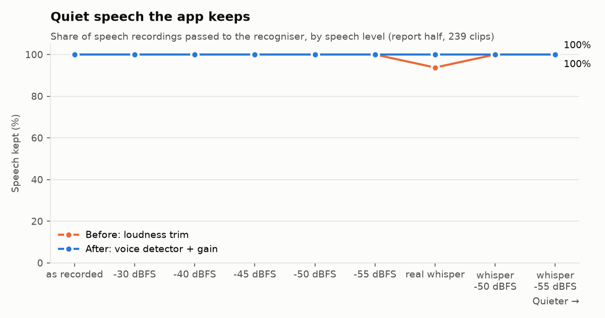
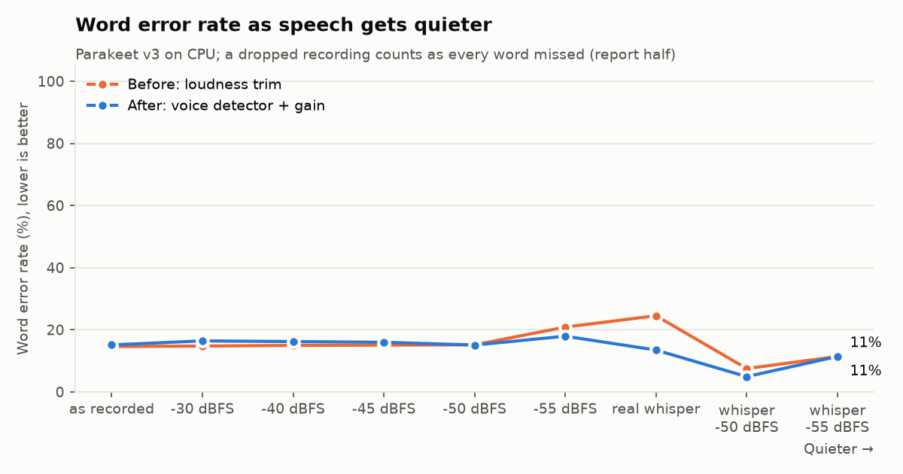
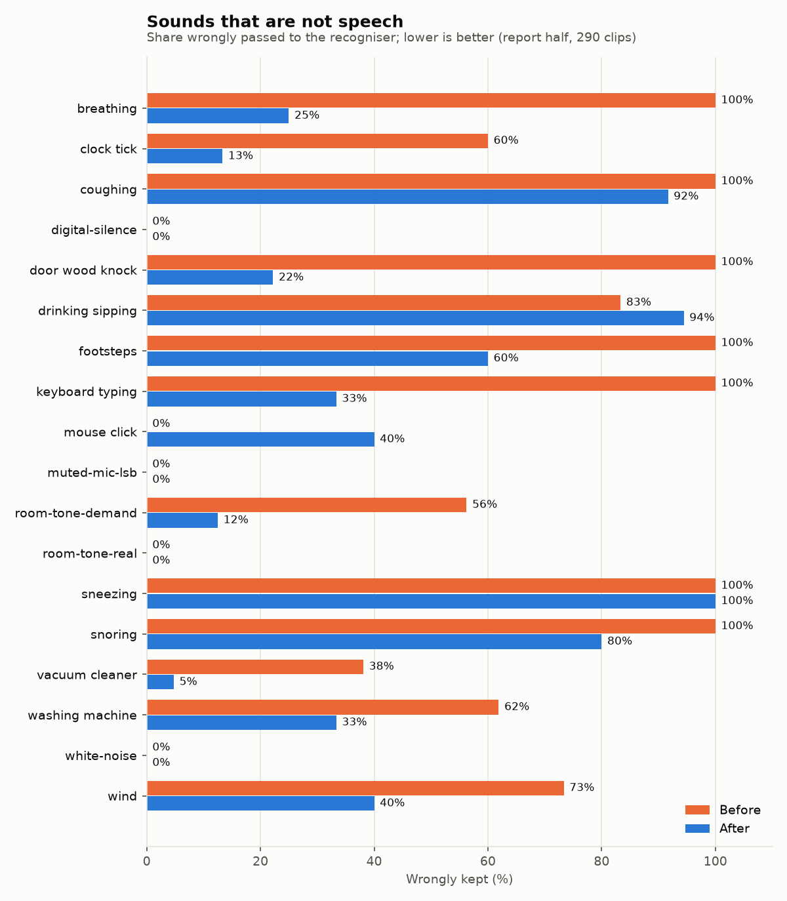
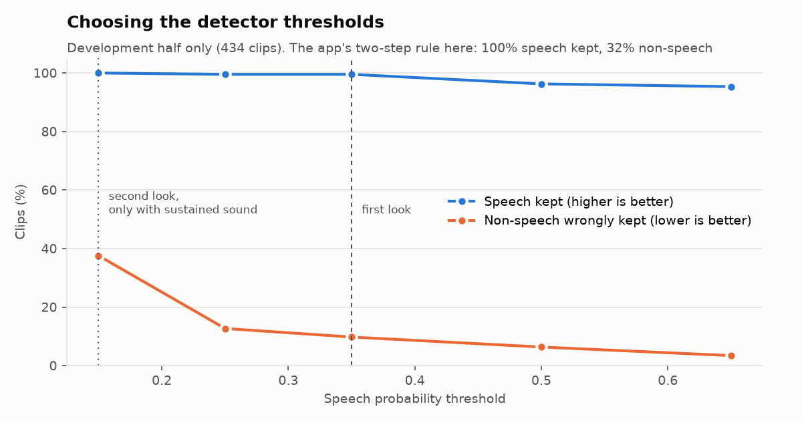
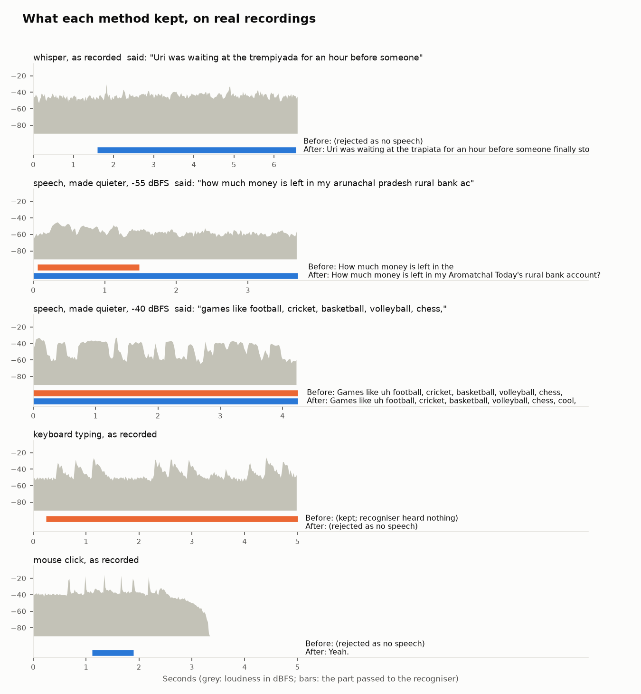

# Speechify evaluation — 11 November 2026

These measurements use the real Rust core. No desktop app or GUI was launched.
The benchmark and analysis are in `bench/`; commands are in `bench/README.md`.
All downloaded data, models, SQLite stores, transcripts, prompts and JSON results
are under `/workspaces/.cache-speechify/eval/`.

## Machine and software

AMD Ryzen 5 3500U, four physical cores/eight logical CPUs, 5,320 MiB reported RAM,
16 GiB swap, Linux x86-64; CPU inference only. Each heavy command ran alone in
`systemd-run --user --scope -p MemoryMax=3500M -- …` (3,670,016,000-byte limit).
Rust 1.99.0, release build, transcribe.cpp native runtime 0.4.1, Q8_0 speech
weights. The runtime selected `libggml-cpu-haswell.so` and reported the CPU device.
Native core uses eight inference threads on this host. The app's uncommitted
source hashes and machine details are recorded in `provenance.json`.

| Role | Catalog ID | Exact Hugging Face revision | SHA-256 |
|---|---|---|---|
| Student | `parakeet-tdt-0.6b-v3` | `d8d8c32cb2017c57e5307767343e97870f8a7f53` | `5859f77944efcd8eafa23a6350731960b2b55b2203df51f319665c807d802cc7` |
| Teacher | `whisper-large-v3-turbo` | `18ada752005f5fddef499256f9a458d0b37a203a` | `257aa7ec9121c22c167d5e2c49e3e76b4ba0e6e27ebc13074eba0a80f8190220` |

Model files were downloaded through `speechify_core::catalog::download` and
checksums were independently checked (`verified-models.json`). Parakeet is the
recommended CPU student. Turbo is the practical teacher here; the default full
Whisper large-v3 and the default 4B/9B cleanup pair were not selected for this
small machine. There are no GPU measurements. These CPU results cannot establish
latency, throughput or model rankings on an NVIDIA GPU.

## Data and fixed selection

[Svarah](https://huggingface.co/datasets/ai4bharat/Svarah) is Indian-accented
English speech. Its source card attributes Javed et al., *Svarah: Evaluating
English ASR Systems on Indian Accents*, INTERSPEECH 2023, and declares
[CC BY 4.0](https://creativecommons.org/licenses/by/4.0/).
The original audio endpoint returned HTTP 401 without credentials. This run used
the publicly downloadable [Bhargav0044/svarah1 mirror](https://huggingface.co/datasets/Bhargav0044/svarah1),
revision `00349cb980a38a68a1638f860e944a3bddabd5a7`, through Hugging Face's rows
and cached-audio APIs. Every audio URL's revision was checked. The mirror has
6,656 rows, matching the original card's count, but mirror provenance and
transcript equivalence were not independently verified against gated audio.
The mirror card adds no license statement. Both cards are retained in the cache.
No downloaded code was imported or executed.

`prepare.py` selected 60 random clips from 3,953 rows lasting 3–15 seconds, with
Python RNG seed **20261111**. The first 30 sampled clips form history; the next
30 are held out. An additional 24 disjoint clips form the recurring-term
scenario, selected solely from reference text before recognition: take the four
most frequent eligible terms from the checked-in candidate list, then sample
six clips per term, with three history and three test clips. The terms are
**Karnataka, Kerala, Pradesh and Maharashtra**. Selection did not use model
errors or any other service's transcripts.

| Scenario | Clips | History / test | Audio seconds |
|---|---:|---:|---:|
| general | 60 | 30 / 30 | 431.416 |
| recurring | 24 | 12 / 12 | 140.250 |

There are 84 distinct waveforms, 571.667 seconds (9.528 minutes) in total,
with median clip length 6.206 seconds. No waveform hash or identical reference
text crosses a history/test boundary. The mirror omits speaker identifiers;
this is **clip-held-out**, not speaker-held-out. These are narrow, small samples
of Indian English, not a population-wide accuracy claim. Waveform hashes,
source row indexes, references and the split are in `manifest.json`;
`selection.json` records the selection counts and candidates.

## Procedure and interpretation

The primary run uses English, CPU, Slack/work category, formal style, Indian
spelling/numbers, Light cleanup, rewrite disabled, auto-learning enabled and
`learn_after=2`. It calls actual `pipeline::run` for every baseline clip and saves
history PCM16 WAV paths and `Dictation` rows marked pasted in fresh SQLite
stores. General and recurring scenarios have separate stores.

Actual `teacher::review` opens Whisper turbo and reviews the stored history.
Batch size is one for incremental checkpoints (the app default is 200).
Dictionary updates, pending suggestions and worked examples come from production
`learn.rs` and `Store`; they are not independently reimplemented. The learned
student run opens Parakeet again and calls actual `pipeline::run` on **all** clips
with the populated store, including real recognition with its vocabulary hints.
Held-out output is not saved into history and never used to teach the store.
The history effect is reported separately as **in-sample**.

A selected history clip, row 3274, was classified Silent by production
trimming. Its empty hypothesis remains in student WER; as in the app, it creates
no history row. Thus 41 recordings are reviewed: 29 general, 12 recurring.
Teacher reference WER is measured on those reviews only; teacher test-set ASR
is not measured. Teacher/student comparisons also show the same-clip student
score. The teacher's better transcripts are not assumed to be reference truth.

Accuracy uses an independent word-level Levenshtein implementation in
`analyse.py`: lowercase; delete punctuation; retain letters, digits and word
boundaries; **no number expansion/contraction or spelling normalization**.
Thus “25” versus “twenty five”, “centre” versus “center”, and alternate name
spellings count as errors. Corpus WER is total edits / reference words.
Intervals use 10,000 nonparametric clip bootstrap draws, seed 20261111.
The learned-minus-empty WER difference uses paired draws of identical clip
indexes; negative differences favor learning. Better/worse counts compare
per-clip edit counts. A [0, 0] interval when every observed pair is unchanged
describes this sample; it does not rule out rare gains on other vocabulary.
The same-speaker dependence that cannot be recovered from this mirror may
make clip-bootstrap intervals too narrow.

The app's displayed “accuracy” is separately evaluated as its actual
`1 - mean(teacher_wer)`, clamped to [0, 1]. It uses teacher words as reference,
normalizes surrounding punctuation only, and averages clips rather than words.
It measures agreement with an imperfect teacher, not true recognition accuracy.

Trimming and rule formatting have separate high-resolution timings from
production-code replays. Recognition has a timed native recognizer wrapper.
`pipeline_ms` times the full real call, including store lookups, excluding WAV
decoding and saving; replay timings are not added to it. First inference is
included. RTF is recognition seconds / original audio seconds, not trimmed
length. Model load is process-cold `Engine::open`; OS file cache is uncontrolled
and Whisper memory-maps weights, so this is not disk-cold loading.
The baseline includes one zero recognition time because trimming bypassed ASR.

The first teacher process was intentionally interrupted after seven reviews.
A per-clip SQLite backup restored the unfinished eighth review; all seven saved
rows survived, with no duplicate IDs (`restart-test.json`). JSON floating-point
round trips were checked with 1e-12 tolerance. Native results are saved after
each clip. No score is extrapolated from incomplete inference.

## Native recognition and speed

| Scenario / output | Clips | Edits / reference words | WER | Bootstrap 95% CI |
|---|---:|---:|---:|---:|
| Random: student pipeline raw | 60 | 173 / 882 | 19.61% | [13.05, 27.53]% |
| Random: student rules output | 60 | 115 / 882 | 13.04% | [7.89, 19.98]% |
| Random: student raw, ASR reached only | 59 | 148 / 857 | 17.27% | [12.04, 23.55]% |
| Random: teacher raw, history only | 29 | 44 / 395 | 11.14% | [3.89, 21.39]% |
| Recurring terms: student pipeline raw | 24 | 41 / 324 | 12.65% | [7.64, 18.77]% |
| Recurring terms: student rules output | 24 | 33 / 324 | 10.19% | [6.02, 15.34]% |
| Recurring terms: student raw, ASR reached only | 24 | 41 / 324 | 12.65% | [7.64, 18.77]% |
| Recurring terms: teacher raw, history only | 12 | 16 / 178 | 8.99% | [3.02, 17.81]% |

The general-sample student pipeline score includes the 25-word Silent failure.
On the same 29 reviewed general clips, the student's raw WER is
18.48% versus the teacher's 11.14%.
General same-clip teacher-minus-student raw WER difference: -7.34 percentage points, paired 95% CI [-17.89, 2.15] points.
Recurring same-clip teacher-minus-student raw WER difference: -4.49 percentage points, paired 95% CI [-8.60, -1.20] points.

| Stage / model | Calls | Median | p95 |
|---|---:|---:|---:|
| Silence trim, production replay | 84 | 0.164 ms | 0.303 ms |
| Parakeet native recognition | 84 | 1933.893 ms | 3805.146 ms |
| Rules composition, production replay | 84 | 0.094 ms | 0.130 ms |
| Parakeet full pipeline, no LLM | 84 | 1934.522 ms | 3805.808 ms |
| Whisper turbo native recognition | 41 | 35489.529 ms | 38803.797 ms |

| Model | Recognition RTF median / p95 | Process-cold opening observations |
|---|---:|---:|
| Parakeet baseline | 0.307 / 0.436 | 775.404 ms |
| Whisper turbo | 5.182 / 10.800 | 73.271 ms, 101.423 ms |
| Parakeet rerun | 0.273 / 0.407 | 937.172 ms |

The 41 completed teacher transcriptions consumed
24.76 minutes of native inference,
excluding the intentionally interrupted attempt. The rerun's Parakeet median
pipeline time was 1.748 seconds; no
weight or dictionary change occurred. This timing difference is run/order/system
variation, not a measured speedup from learning. There is one full pass per
configuration, not repeated randomized latency trials.

Recognition accounts for essentially all measured pipeline latency. The native
student consumed 7.59 CPU seconds per wall second and the live teacher sample
7.62 (`teacher-profile.json`), using almost all eight logical CPUs. This shows
we timed CPU inference, not network waits or file decoding. It does not separate
compute throughput from memory bandwidth. The sub-millisecond trim and rules
stages cannot explain a material end-to-end speed change. OS activity, thermals
and swap were not experimentally controlled on this shared laptop.
Whisper's fast opening is a memory map; actual first inference is included in
the recognition measurements. No GPU speedup is estimated.

## Did native teacher learning improve dictation?

This comparison scores **final formatted text** against the references.

| Scenario / split | Clips | Empty-store WER | Learned-store WER | Difference, points (95% CI) | Better / worse / unchanged |
|---|---:|---:|---:|---:|---:|
| Random: held out | 30 | 10.17% | 10.17% | +0.00 [0.00, 0.00] | 0 / 0 / 30 |
| Random: history — in-sample | 30 | 16.19% | 16.19% | +0.00 [0.00, 0.00] | 0 / 0 / 30 |
| Recurring: held out | 12 | 9.59% | 9.59% | +0.00 [0.00, 0.00] | 0 / 0 / 12 |
| Recurring: history — in-sample | 12 | 10.67% | 10.67% | +0.00 [0.00, 0.00] | 0 / 0 / 12 |

Every raw and formatted transcript was byte-for-byte unchanged in the real
native rerun, on history as well as test. There is **no measured improvement**
from the rules-only teacher loop in this sample, and no observed worsening.
There are no “better” or “worse” examples to list for this comparison.

| Store | Reviewed | Accepted dictionary corrections | Unique pending suggestions | Stored cleanup examples |
|---|---:|---:|---:|---:|
| General | 29 | 0 | 11 | 14 |
| Recurring | 12 | 0 | 3 | 7 |

All pending suggestions have one observation, below `learn_after=2`. Examples
are not used at all by rule-based cleanup. This is a dictionary/examples system,
not model-weight training, so an empty learned dictionary gives the native
student nothing new in this configuration.

Examples of unchanged held-out output (both stores):

- Clip 1339 (general): reference “games like football, cricket, basketball, volleyball, chess,”; both outputs “Games like football, cricket, basketball, volleyball, chess, cool,” (1 word edits).

- Clip 6613 (recurring): reference “north karnataka is predominantly famous for hindustani music and south karnataka is well”; both outputs “South Karnataka is predominantly famous for Hindustani music, and South Karnataka is very.” (2 word edits).

No applied correction made text worse because none was accepted. Pending does
not mean correct: general history proposed `bu → Biu`, while the reference says
“bihu”; it was not applied. Other pending examples include `shorts → shots`,
`will end → lend`, and `flavour → flavor`. The last is a spelling variant, not
an obvious improvement for Indian English. All suggestions/examples are retained
in the two `*-learning.json` files.

The controlled selection demonstrates a limit of recurrence alone. Exact target
term presence in student raw output was:

| Term | History correct / clips | Held-out correct / clips |
|---|---:|---:|
| karnataka | 3 / 3 | 3 / 3 |
| kerala | 3 / 3 | 2 / 3 |
| maharashtra | 3 / 3 | 3 / 3 |
| pradesh | 2 / 3 | 3 / 3 |

These are literal target-word presence counts, not full-utterance accuracy.
The names recur, but only one history clip misses its target word. The same
mishearing did not recur twice, so this gives limited evidence about dictionary
learning under repeated identical recognition errors. The set was not replaced
or retuned after seeing that result. The held-out Kerala miss remained a miss.

## Does displayed “accuracy” track reference accuracy?

Use the same reviewed clips for both scores. “Reference accuracy” below is
1 minus **mean per-clip raw WER**, to match the app's averaging; it is not
1 minus corpus WER.

| Scenario | Clips | App mean student-vs-teacher WER | Displayed accuracy | Reference mean-clip accuracy | WER correlation (Pearson r) |
|---|---:|---:|---:|---:|---:|
| General | 29 | 22.91% | 77.09% | 79.23% | 0.928 |
| Recurring | 12 | 8.81% | 91.19% | 85.61% | 0.933 |

Agreement tracks clip difficulty strongly here, but is not calibrated accuracy:
it understates mean-clip reference accuracy by 2.15 points on general history
and overstates it by 5.58 points on recurring history. On clip 6355, both models
say “Show a list of all available vaccination centers in state of Karnataka.”
The reference says “show a list of all available vaccination center in state
karnataka”. Agreement gives zero error while reference scoring counts two edits.
Shared errors and reference spelling variants are invisible to teacher agreement.

The teacher itself also fails: on clip 490, the nine-word reference is
“to a tehzeebic culture or the mannerism of urdu.” Parakeet says “They're the
same.”; Whisper turbo says “Participant Bata Redo & Podd contenido is an extreme
I it's a extreme I want to miss that”. Teacher reference WER is 17/9 = 188.89%.
This failure stays in all reported averages; it was not removed as an outlier.

## Formatting and small-language-model setup

The frozen `bench/cases.json` contains 32 inputs selected from the existing
format unit tests, adapted to the complete formal/Indian pipeline, plus 20 new
inputs covering lists, self-corrections, Indian numbers, fillers and ordinary
sentences that must stay intact. Exact expected text was written before runs;
it was not adjusted to match outputs. This is a small authored regression set,
not a blind human rating study. Valid paraphrases, different number notation
and punctuation choices can fail exact match; inspect the listed failures.

Rule-based output was exactly right on **49/52 (94.23%)**: 32/32 existing inputs
and 17/20 new inputs. Median composition time was 0.063 ms, p95 0.227 ms;
the first cold rules call took 8.016 ms. All rule failures:

| Case | Spoken input | Expected | Actual rules output |
|---|---|---|---|
| new-05 | Send it in May, actually June. | Send it in June. | Send it in May, actually June. |
| new-06 | Send it in April, actually May. | Send it in May. | Send it in April, actually May. |
| new-18 | We should discuss the new line of credit. | We should discuss the new line of credit. | We should discuss the Of credit. |

The optional model is **Gemma 3 1B IT, Q4_K_M**, `gemma3:1b`, via Ollama
**0.40.6**. Exact registry digest:
`97558784bdc9175075a72655bf360b15da17df6b3b9e5182af9f8c0c8e58ba7c`;
weight blob SHA-256:
`2f8c3d137f2496dcb4019e17a50f2974b89c1be1a742db3c80cc86f91cafeeef`.
The downloaded model package is 806,067,407 bytes. It uses CPU only, one runner,
one parallel request, context length 2,048, temperature zero and streaming off.
All ASR processes exited before the language model loaded. The model was made
resident with the app-style empty warm request, taking 2.891 seconds; this
warms weights, not a complete cleanup prompt. The server log confirms CPU
buffers and the configured context. This is the one language model pulled.

The full 52-case model run calls actual `pipeline::compose`, `Chat`,
`cleanup_prompt`, `vet_cleanup`, and `format::finish`. Minimum words is zero
so every case attempts the model; the real everyday **six-second timeout** is
retained. Result: **52/52 request timeouts, 52/52 fallback to rules, zero
successful model answers, zero answer-vetting rejections**. Final output is
49/52 correct entirely because it is the rule result. There are no successful
vetted model outputs from which to estimate quality under this timeout.
Median added model-call time is **6.143 seconds**, p95 **6.144 seconds**.

For many requests, the runtime log records full prompt reprocessing because
cache data cannot be reused (SWA/hybrid memory). A completed long-budget diagnostic
shows about 406 prompt tokens taking 9.81 seconds (41.40 tokens/second), already
beyond six seconds before generation. This identifies real model work behind
the timeout; weights were resident and requests did not fail for missing models.
These are observations of this exact Ollama/model/runtime combination, not a
claim about every 1B model or runtime.

A **separate quality-only diagnostic** runs the same 20 new frozen cases with
a 180-second request budget. It is not an app-latency result, and does not change
the timeout used for the held-out student cleanup comparison.

On the 20-case long-budget diagnostic, final output was exactly right on
**1/20 (5.00%)**, versus rules' 17/20 on the same new cases.
Vetting accepted 19 model rewrites: **0/19** exactly matched the expected text.
It rejected 1/20 answers; that single fallback produced the one correct final
output. There were no HTTP timeouts or errors. Model-call median latency was
9.621 seconds, p95 12.176 seconds. The six-second path's absence
of answers is a latency result, not evidence that the model gets these cases
right. Most accepted failures add an unrequested numbered-list marker; some
also delete or reword content. These are exact-match results for this model,
prompt and runtime, not a judgment of all small language models.

All long-budget failures (the successful new-17 result came from rules after
Gemma proposed ten repeated “Bank account number:” list items):

| Case | Input | Expected | Vetted/final output |
|---|---|---|---|
| new-01 | First, check the invoice. Second, pay the supplier. | 1. Check the invoice 2. Pay the supplier | 1. Invoice check 2. Supplier payment |
| new-02 | Shopping list: bullet rice bullet tea bullet dal | Shopping list: - Rice - Tea - Dal | 1. Shopping list: 2. Bullet 3. Rice 4. Bullet 5. Tea 6. Bullet 7. Dal |
| new-03 | I have one meeting and two calls today. | I have one meeting and two calls today. | 1. Meeting 2. Calls |
| new-04 | The second train arrives after the first. | The second train arrives after the first. | 1. Second 2. Train 3. Arrives 4. After 5. First 6. Train |
| new-05 | Send it in May, actually June. | Send it in June. | 1. Send 2. In 3. May 4. Actually 5. June. |
| new-06 | Send it in April, actually May. | Send it in May. | 1. Send 2. In 3. April 4. Actually 5. May. |
| new-07 | Meet on Thursday, no wait, Friday. | Meet on Friday. | 1. Meeting 2. Thursday 3. Friday |
| new-08 | The price is two lakh, actually three lakh rupees. | The price is ₹3 lakh. | 2 lakh, actually 3 lakh rupees. |
| new-09 | The total is one crore twenty five lakh rupees. | The total is ₹1,25,00,000. | 1. 1 crore 25 lakh rupees |
| new-10 | The discount is twelve point five percent. | The discount is 12.5%. | 1. Discount: 12.5% |
| new-11 | Please pay one thousand and fifty rupees. | Please pay ₹1050. | 1. One thousand and fifty rupees. |
| new-12 | The code is zero zero seven five. | The code is 0075. | 1. Zero zero seven five |
| new-13 | Um, please, uh, send the file. | Please, send the file. | 1. File 2. Send |
| new-14 | I I will send the the updated report. | I will send the updated report. | 1. Report 2. Updated 3. Sent |
| new-15 | She had had a very very long day. | She had had a very very long day. | 1. Long 2. Day |
| new-16 | The summer programme begins tomorrow. | The summer programme begins tomorrow. | 1. Summer programme begins tomorrow. |
| new-18 | We should discuss the new line of credit. | We should discuss the new line of credit. | 1. New line of credit |
| new-19 | The doctor will examine the colon tomorrow. | The doctor will examine the colon tomorrow. | 1. Colon examination 2. Colon tomorrow |
| new-20 | The bullet train has two stops. | The bullet train has two stops. | 1. Bullet train 2. Two stops |

## Reproduced core issues; no core changes made

1. **Quiet speech can be erased before ASR or teacher review.**
   `core/src/audio.rs:9` and `:64` impose RMS floor 0.004. Row 3274 lasts
   10.3438 seconds; its peak 20 ms RMS is 0.003591 and overall RMS 0.000918.
   Production trim returns zero samples and the pipeline returns Silent, losing
   all 25 reference words and preventing a reviewable history record. Direct
   Parakeet recognition of the same original PCM, without trimming, has only
   2/25 edits and says “…in no way can we call them global languages.” At fixed
   4× gain, the production pipeline also produces text. This is not merely an
   audio file with no speech. Reproduction: the `quiet-probe` command in
   `bench/README.md`, with outputs in `quiet-probe.json`. The diagnostic does
   not change baseline scores or establish that global 4× gain is the right fix.

2. **Self-corrections involving May are missed.**
   `core/src/format/backtrack.rs:70` omits May from `MONTHS`.
   Cases new-05/new-06 reproduce “Send it in May, actually June.” and “Send it
   in April, actually May.” passing through unchanged. Expected results are
   “Send it in June.” and “Send it in May.” Run `format bench/cases.json …`
   without `llm`; the three-rule-failure table gives exact outputs.

3. **A natural phrase triggers a spoken line-break command.**
   `core/src/format/spoken.rs:6` matches “new line” globally. Case new-18,
   “We should discuss the new line of credit.”, becomes
   “We should discuss the\nOf credit.” This changes an ordinary sentence.
   The same rule-only formatting command reproduces it.

4. **Large, unrelated teacher output is accepted as a worked example.**
   `core/src/teacher.rs:149` has no quality/disagreement gate before adding
   teacher ideals as examples. In the real review, clip 490's unrelated output
   became the newest work-category example. `Store::examples(Work, 3)` returns
   it first. The dictionary change filter rejected the large recognition
   difference, but that protection does not cover the example path.
   `example-probe` reconstructs just this one actual record in a fresh in-memory
   store, replays the measured teacher words through real `teacher::review`,
   and yields one example, zero dictionary entries, with app disagreement WER
   1.0 (`example-probe.json`). Reference text is not substituted as recognition.
   The result proves acceptance of this example, not that it caused a measured
   held-out regression. The learner should not treat teacher text as verified
   truth just because it came from a larger model.

## Teacher language model and held-out cleanup examples

This additional **cleanup-only ablation** seeds fresh stores with the actual
rule-formatted history recorded while Ollama was absent. It reuses the already
measured native Whisper transcripts through a replay `Recognizer`, then calls
real `teacher::review` with Gemma 3 1B and the desktop teacher's 180-second
rewriter timeout. Both held-out conditions receive the **same frozen baseline
Parakeet raw transcript**, isolating cleanup/dictionary/examples from ASR
vocabulary changes. Actual `pipeline::compose` builds each prompt and vets its
answer. Student settings retain minimum six words and the six-second timeout.
This avoids simultaneous ASR/LLM memory, and is not a new measurement of joint
ASR-plus-LLM inference or of default 4B/9B language models.

The 41 teacher cleanup calls completed with no HTTP errors. Model-call median
was 11.483 seconds, p95 14.863 seconds, maximum 116.950 seconds.
Two requests exceeded 100 seconds. One generated a 3 KB repeated numbered list
for “composition of shots”; production vetting rejected it and retained rules.
These slow calls are included, not retried with friendlier settings.

| Store after language-model teacher | Dictionary entries | Pending suggestions | Stored examples |
|---|---:|---:|---:|
| general | 0 | 11 | 18 |
| recurring | 0 | 3 | 10 |

| Held-out cleanup scenario | Clips | Empty-store WER | Learned-store WER | Difference, points (paired 95% CI) | Better / worse / unchanged |
|---|---:|---:|---:|---:|---:|
| general | 30 | 10.17% | 11.04% | +0.87 [0.00, 2.87] | 0 / 1 / 29 |
| recurring | 12 | 9.59% | 9.59% | +0.00 [0.00, 0.00] | 0 / 0 / 12 |

All 42 empty-store calls timed out and used rules. Learned-store calls had 37
request timeouts, four answer-vetting rejections, and one accepted model answer.
Thus 83/84 final outputs used rules. The loop again showed **no improvement**.
The positive difference is one observed regression, with an interval including
zero; it does not establish a stable harmful effect of example learning.

The worse clip is **566**, with ten reference words:

- Reference: “because i stay in a warm place. so, during summer”
- Frozen student raw: “I stay in a warm place so during summer uh”
- Empty-store final output: “I stay in a warm place so during summer.” — 1 edit.
- Learned-store final output: “I stay in a warm place so during summer uh: 1. Warm Place.” — 5 edits.

The accepted learned-store call completed in 3.022 seconds. There was no applied
dictionary correction: the difference is the rewrite/fallback path. Its output
kept a filler and added an unrequested list item; word-overlap vetting let it
through. An unchanged recurring example and all other unchanged/better/worse
lists are retained in `cleanup-summary.json`; no held-out clip improved.

Requests were paired in fixed empty-then-learned order, with one loaded model.
Cache state and the deadline can change which condition returns a model answer.
Consequently this run measures the resulting pipeline behavior, not a clean
causal effect of few-shot knowledge alone. The separate request-order probe
rechecks the accepted-rewrite case without replacing this original result.

In the follow-up `cleanup-probe.json`, clip 566 was requested in learned/empty
and then empty/learned order. **All four calls timed out**, each returning the
same rule output with one edit. The accepted rewrite did not recur. This limits
attribution: the original +0.87-point difference is a measured result of that
ordered run, not a robust estimate that teacher examples themselves worsen
accuracy. Backend/cache/timing state affects whether a rewrite is available.

## What remains unmeasured

- NVIDIA GPU latency, memory, throughput and accuracy; this machine has no usable
  GPU for these runs. CPU times cannot be converted into GPU estimates.
- The full Whisper large-v3 default teacher, the default 4B/9B language models,
  and additional students. The CPU time and memory budget went to one complete
  speech pairing and one allowed small language model; larger downloads were
  not attempted. This is not a broad model-ranking study.
- Joint loaded-ASR/LLM latency or total app memory, microphone/device capture,
  keyboard release, clipboard delivery and GUI behavior. GUI launch was excluded
  by request, and the two model families were deliberately never co-loaded.
- Teacher ASR on held-out clips; its reference score uses the 41 real reviews.
- Speaker-held-out generalization, long-term learning across days, recurring
  identical mishearings at scale, user-edit learning, independent blind human
  ratings, and semantic rather than exact-match formatting scores. This mirror
  lacks speaker IDs; the recurring targets were mostly already recognized.

Requests were issued back-to-back without human recording pauses. Canceled
language-model work can briefly continue on the server, affecting the next
request. No inference models were run concurrently. Light provenance/file reads
occurred during the initial native pass; the independent native rerun is also
reported. Shared-machine activity, temperature and OS cache were uncontrolled.
Reference spellings/transliterations and number notation can inflate strict WER.
No bootstrap interval removes those limitations.

## What this means for the owner

Parakeet plus rules is usable for draft dictation on this weak CPU laptop:
about two seconds of post-recording processing at the median, with p95 near
four seconds. It is not instant. The random Indian-English sample still needs
13.04 word edits per 100 reference words after rules, and names/rare terms can
fail badly. That supports reviewing the text; it does not support promising
accurate unattended dictation across Indian accents.

The teacher did **not earn its CPU cost as a student-improvement mechanism in
this window**. Its speech transcripts had a lower mean WER, but it accepted no
dictionary correction, and the native held-out output did not change. With the
small language model enabled, there was no held-out gain and one non-repeatable
rewrite regression. This does not disprove benefits from longer histories with
repeated identical errors, trusted edits, or stronger models on other hardware.
It does show that “a larger model reviewed it” is not evidence that live
dictation improved. Historical review/export may still be useful on its own.

On this CPU, the tested 1B cleanup model adds a six-second wait to fallback in
the normal formatting run. Giving it more time did not make its outputs reliable:
zero of 19 accepted diagnostic rewrites exactly matched the required result.
The model used as teacher rewriter also consumed real time to produce list-heavy
ideals, including two requests over 100 seconds. More examples are not
necessarily better examples.

The top three changes suggested by these measurements are:

1. **Fix quiet-speech detection before ASR.** One real 25-word recording was
   discarded; direct recognition recovered it with only two edits. Evaluate an
   adaptive gain/noise-relative detector against quiet speech and actual silence,
   rather than declaring every frame below a fixed RMS floor to be non-speech.
2. **Gate teacher examples and auto-learning on trustworthy evidence.** The
   dictionary's large-change filter did not protect examples. Reject or request
   confirmation for grossly unrelated teacher ideals, retain provenance, and
   evaluate confirmed recurring errors on held-out dictation before treating
   teacher agreement as accuracy. A nonsensical newest example must not become
   a preferred prompt example automatically.
3. **Make CPU cleanup earn both its latency and quality budget.** Prefer the
   measured fast rule path here, back off from repeatedly timing-out rewriters,
   and require quality checks before enabling a small model. Tighten vetting of
   unrequested structure, and close the rule path's May and natural “new line”
   gaps. The observed 1B model is not a useful fallback simply because it fits RAM.

## Reproduction, artifacts and checks

Start with `bench/README.md`. The binary-only `speechify-bench` crate is a
workspace member and is excluded from `default-members`. Its dependencies reuse
core's exact Serde pins: serde 1.0.229 (published 18 July 2026) and serde_json
1.0.154 (11 October 2026), both before the required 27 October cutoff.
`cargo check -p speechify-bench` refreshed the lockfile without dependency
upgrades. Python tools use the standard library (Python 3.14.4 in this run).

All result paths below are relative to `/workspaces/.cache-speechify/eval/`:

| Artifact | Contents |
|---|---|
| `manifest.json`, `selection.json`, `inputs-sha256.json` | Fixed data, splits, seed and hashes |
| `parakeet/baseline.json`, `parakeet/teacher.json`, `parakeet/learned.json` | Every completed native inference/review |
| `parakeet/summary.json` | Native WER, confidence intervals, paired effects, examples and timings |
| `parakeet/*-learning.json`, `parakeet/*.sqlite` | Actual learned dictionary, pending suggestions, examples and history |
| `format-rules.json`, `format-gemma.json` | Full 52-case rule and normal-timeout runs |
| `format-gemma-quality.json` | All 20 long-budget model answers, prompts, vetting/fallback and failures |
| `parakeet-gemma/cleanup.json`, `parakeet-gemma/*-learning.json`, `parakeet-gemma/*.sqlite` | Complete language-model teacher and held-out cleanup ablation |
| `cleanup-summary.json` | Formatting and cleanup paired statistics, every failure and example |
| `quiet-probe.json`, `example-probe.json`, `cleanup-probe.json` | Minimal reproductions and order diagnostic |
| `*-pin.json`, `verified-models.json`, `ollama-*.json` | Exact models, digests, metadata and measured load/warm details |
| `provenance.json`, `dependency-dates.json`, `restart-test.json`, `validation.json` | Machine/source evidence, dependency dates, resume proof and final checks |
| `evaluation-comparison.html` | Inline confidence-interval chart |
| `*.log`, `*-profile.json`, `*-scope.txt`, `parakeet/*-process.txt` | Build, inference, runtime and resource evidence |

`cargo fmt --all --check` and
`cargo clippy --workspace --all-targets --locked -- -D warnings` both passed.
File hashes confirm that no existing files in core, os, src-tauri, src, tests,
.github, scripts or the pre-existing docs changed. No commit, push, stash, sudo
or GUI launch was used. The benchmark's Ollama server was stopped and its port
was verified unreachable. All selected clips and requested comparisons finished;
the only interrupted inference was the deliberate resumability test.

## After fixes — 11 November 2026

The findings above are the original evaluation and remain unchanged. This follow-up
uses the same models, waveforms, references, split and bootstrap seed. Development
used history only. Implementation was frozen before the new native baseline;
held-out results were scored only after both new student passes completed. No
reference text was supplied to recognition, review, vocabulary or examples.
The benchmark and analysis changes are reproducible from the additional commands
in `bench/README.md`; new artifacts use `after-fixes/` and `fixes-*` paths.

### Changes and development evidence

- Trimming now derives its threshold from the recording's noise floor and peak
  frame energy, requires sustained sound as well as 160 ms total activity, and
  raises already-detected quiet speech with bounded gain. Synthetic tests cover
  the discarded clip's low-level syllable envelope, silence, room noise and
  repeated clicks; no dataset audio was added to the repository. In
  `fixes-quiet-probe.json`, row 3274 now returns text on the original PCM, with
  exactly the same final output as the 4× input-gain probe. It previously returned
  Silent. The detector remains an energy heuristic, not a trained speech detector.
- May participates in self-corrections only with calendar or capitalisation
  evidence. Ordinary modal verbs remain unchanged. Layout noun phrases such as
  “a new line of products” and “the next paragraph” remain text. The unchanged
  52-case fixture now passes **52/52**, versus 49/52 originally.
- Teacher examples require compatible transcripts (at most 40% word disagreement
  in either direction), plausible length, word overlap with both transcripts,
  and cleanup vetting. Unrequested numbered/bulleted structure is rejected in
  everyday cleanup too. User hand-edits remain trusted. Replaying the exact
  clip-490 failure now stores **zero examples**, versus one originally
  (`fixes-example-probe.json`). Silent history is skipped before recognition.
- Two consecutive failed or rejected rewrites open a one-minute circuit breaker.
  Dictation immediately uses rules during cooldown, then probes again; a failed
  probe renews cooldown. Success or changed rewrite settings resets it. Tests use
  the injected platform clock without sleeping. Command Mode still explicitly
  requests the model. `Controller::rewrite_retry_at_ms` exposes status, and
  guarded composition reports a fallback reason. Interface wiring is outside
  this change's permitted scope.
- The legacy `accuracy` API field is now null. The same arithmetic is available
  as `teacher_agreement`, explicitly distinct from ground-truth accuracy. The
  existing interface's heading and empty-state explanation still need relabelling
  in a separate interface change; no numeric teacher score is sent as accuracy.

The original zero-learning result had several concrete causes: every one of the
14 proposed corrections appeared once, below the two-sighting threshold; large
or insertion/deletion changes were intentionally filtered by `learn::corrections`;
rules never consumed worked examples; and no notable-term vocabulary was added.
The new native benchmark also records the runtime's actual vocabulary capability:
this Parakeet model reports **false**, while Whisper reports **true**. Passing
more glossary words cannot bias this Parakeet decoder. The original repeated
names were mostly already recognised correctly, and repeated names are not
necessarily repeated identical recognition errors.

The learner now adds notable terms supported by both recognisers as plain
vocabulary, respecting auto-learning and forgotten entries. It can accept a
single correction when a capitalised student term has a small edit distance to
an independently known corrected spelling. Unsupported spellings remain pending.
Exact dictionary rules still apply at format time on every recogniser; broad
fuzzy rewriting of ordinary words was not introduced.

The history-only replay (`fixes-history-final/history.json`) compared this policy
with a permissive first-sighting ablation that substituted the proposed spelling
itself for independent evidence. On general history the permissive ablation
changed WER from **16.19% to 15.95%**, with **2 better / 1 worse / 27 unchanged**;
recurring history stayed **10.67%**, **0 / 0 / 12**. The improvement candidates
were Pensin→Pension and Kerr→Kher, but Ekanatha→Ekanatham changed a correct name
into a wrong one. The permissive policy was rejected despite its small net gain.
The shipped policy caused **0 worse** clips in this frozen-transcript history
check (0 / 0 / 30 general, 0 / 0 / 12 recurring). Unit tests additionally prove
that independently corroborated first sightings are applied, ordinary lowercase
words are protected, forgotten vocabulary stays forgotten, and auto-learning off
adds no vocabulary. Agreement between recognisers still does not prove truth.

### Final native held-out result

This is the primary native/rules study repeated in fresh SQLite stores, with all
84 clips in each student pass and all **42 history recordings** reviewed by the
real native teacher. The original quiet recording is now reviewable. Teacher ASR
was not run on held-out audio. The optional 180-second teacher-language-model
cleanup ablation was not repeated; its original negative findings above remain.

All intervals below use the original 10,000 clip-bootstrap draws. “All fixes”
compares the original baseline with the new learned-store output; positive
WER differences are worse. Both new empty and learned results are shown so that
trimming/recognition changes are not misattributed to learning.

| Scenario / held-out clips | Original WER (95% CI) | New empty-store WER (95% CI) | New learned-store WER (95% CI) | All-fixes difference, points (paired 95% CI) | Better / worse / unchanged versus original |
|---|---:|---:|---:|---:|---:|
| General / 30 | 47/462 = 10.17% [6.14, 15.35]% | 49/462 = 10.61% [6.62, 15.79]% | 49/462 = 10.61% [6.62, 15.79]% | +0.43 [0.00, 1.42] | 0 / 1 / 29 |
| Recurring / 12 | 14/146 = 9.59% [4.79, 15.89]% | 14/146 = 9.59% [4.79, 15.89]% | 14/146 = 9.59% [4.79, 15.89]% | +0.00 [0.00, 0.00] | 0 / 0 / 12 |

**The teacher still produced no held-out WER improvement.** Comparing the new
empty and learned stores, both scenarios have a **0.00-point difference,
paired 95% CI [0.00, 0.00]**: general 0 better / 0 worse / 30 unchanged;
recurring 0 / 0 / 12. Raw recognition is byte-for-byte identical between these
new passes on all 84 clips. Four held-out formatted texts differ only in
capitalisation (three general, one recurring); these are not WER gains. This
observed zero interval does not rule out rare effects on other histories.

The new recognition path has **one held-out regression versus the original**:
clip 4937 changes “Apart from this, there are a number of services provided by
GSRTC.” to “…provided by G SRTC.” The strict scorer counts 0 edits before and
2 after. This difference is already present in the new empty-store run, before
learning. It is not caused by an applied learned correction. A single pass does
not distinguish run variation from the changed trimming input. No rule, gain or
learning policy was retuned after inspecting this held-out result.

History is explicitly **in-sample**: general WER improves from 16.19% to 10.48%,
with 1 better / 0 worse / 29 unchanged; recurring stays 10.67%, 0 / 0 / 12.
The improvement is the recovered quiet recording (row 3274): **1/25** final word
edits instead of the original empty output's **25/25**. The teacher also scores
1/25 on that history recording. Learning itself changes no history WER.

| New store | Reviewed | Accepted replacement corrections | Plain vocabulary entries | Pending suggestions | Worked examples |
|---|---:|---:|---:|---:|---:|
| General | 30 | 0 | 16 | 9 | 9 |
| Recurring | 12 | 0 | 17 | 3 | 6 |

The loop is safer and can now learn from an independently corroborated single
mishearing, but this sample still does not demonstrate a student accuracy gain.
Plain vocabulary is useful only to a recogniser that accepts it (or for exact
capitalisation); Parakeet here does not. Conservative agreement/overlap filters
can also reject legitimate numeric reformattings. The CPU cost of the teacher
is still not justified by held-out improvement in this window. Previously stored
examples are not retroactively purged: the old schema has no example provenance
to distinguish trusted hand-edits from automatic examples. Shared errors,
small clip-held-out samples, missing speaker identities and reference spelling
limitations remain exactly as in the original evaluation.

### Rewrite breaker and final verification

With the same resident Gemma 3 1B, CPU-only server, six-second budget and unchanged
52 frozen formatting cases, `fixes-format-gemma.json` records **2 request timeouts,
50 circuit-breaker skips, 0 successful model rewrites, and 52/52 correct final
outputs**. The first two calls took 6.309 and 6.142 seconds; subsequent cases used
rules immediately. Total measured case time was 12.467 seconds and median case
time 0.099 ms. The saved time is from avoiding 50 requests, not faster model
inference. Back-to-back cases stay within one cooldown; real dictations after
a minute probe again. This is not evidence that the 1B model's cleanup quality
has improved. There was one run, no latency confidence interval or repeated
randomised performance comparison, and no concurrent ASR inference. Ollama was
stopped afterward and port 11434 was verified closed.

The final gates all passed on the frozen Rust sources:

- `cargo fmt --all --check`: exit 0, no output.
- `cargo clippy --workspace --all-targets --locked -- -D warnings`: final line
  `Finished dev profile [unoptimized] target(s) in 7.74s` (Cargo renders `dev`
  in backticks).
- `cargo test --workspace --locked`: 157 core tests and 7 OS tests pass, including
  real native recognition. Last nonempty line is the final doc-test summary:
  `test result: ok. 0 passed; 0 failed; 0 ignored; 0 measured; 0 filtered out; finished in 0.00s`.
- `bash scripts/coverage.sh`: exit 0; `Core: every line is covered.` Frontend
  statements, branches, functions and lines are all 100%. Its literal final
  nonempty line is the coverage report's `================================================================================`.

The frontend coverage runner clears the shared output directory after the core
check. An archived report generated from the same coverage data,
`fixes-core.lcov`, retains **6,142 executable lines and zero uncovered lines**.
No coverage exclusions were added. Gate logs are `fixes-fmt.log`,
`fixes-clippy.log`, `fixes-test.log`, and `fixes-coverage.log`.
`after-fixes/fixes-summary.json` retains every paired result and bootstrap
interval; `after-fixes/summary.json` retains the full existing native analysis.
`fixes-history-final/`, `fixes-format-rules.json`, `fixes-format-gemma.json`,
`fixes-quiet-probe.json`, `fixes-example-probe.json` and `fixes-provenance.json`
retain the development and reproduction evidence. Source changes stay within
core, bench and the two permitted documents. No dependency, dataset audio,
commit, push, stash, reset, sudo, app launch or GUI was introduced.

## Quiet and whispered speech — 13 November 2026

Speechify should hear the user when they speak softly or whisper in an office,
and still ignore a recording with no speech in it. This section measures the
change from a loudness-only trim to a neural voice detector (Silero VAD 6.2,
bundled with the speech runtime) with gain normalisation.

### What changed

- Quiet recordings are raised to a normal level before anything else looks at
  them (gain from the 99.5th-percentile sample, at most 50 dB). A recording
  with no signal at all (below about -80 dBFS) is still treated as a muted
  microphone.
- The voice detector decides whether anyone spoke: speech probability 0.35.
  If it finds nothing but the recording has sustained sound above its own
  background, it looks again at 0.15, because a lost whisper is worse than a
  stray noise for this user.
- The part passed to the recogniser runs from the earliest to the latest point
  that either the detector or the loudness trim found, so soft first and last
  words are not cut.
- Whole recordings are kept for the nightly review instead of the loudness cut.

### Data

965 recordings, 16 kHz mono, 2 to 12 s, built by a reproducible script (seed 7):

| Group | Clips | Source |
|---|---:|---|
| Real whispered English | 84 | Hebrish Whispered-Sentences (CC BY 4.0), Expresso and EARS whisper style (CC BY-NC 4.0) |
| Real whispers made quieter (-50, -55 dBFS) | 40 | as above, attenuated |
| Indian-English speech made quieter (-30 to -55 dBFS), with mic hiss or real room tone | 300 | Svarah clips from the earlier evaluation |
| Indian-English speech as recorded | 30 | Svarah |
| Non-speech: typing, clicks, breathing, coughs, sneezes, snoring, footsteps, knocks, sipping, ticking, appliances, wind, each at 3 levels | 390 | ESC-50 (CC BY-NC 3.0) |
| Real room tone, white noise, digital silence, a muted microphone | 105 | DEMAND, Hebrish room tone, synthetic |
| Cafeteria chatter (reported, not scored) | 16 | DEMAND |

Attenuated speech stays voiced; only the real whispers are unvoiced. The real
whispers come from 24 speakers, mostly studio or phone microphones; none was
recorded on an office laptop. Licences include non-commercial ones, so the
audio is used for evaluation only and is not in this repository.

### Method

`cargo run --release -p speechify-bench -- quiet MANIFEST OUT parakeet-tdt-0.6b-v3`
runs the old loudness trim and the app's own `asr::isolate` on every clip, and
Parakeet TDT 0.6B v3 on CPU on what each keeps. Word error rate counts a dropped
recording as every word missed. Recordings are split into a development half and
a report half by original recording: every piece, level and noise variant of one
recording is on the same side. Thresholds were chosen on the development half;
every number and chart below is from the report half.
`bench/quiet_report.py RESULTS OUT MANIFEST` makes the tables and charts.

The EARS whispers are halves of longer takes, but the corpus mirror gives only
the whole take's transcript. Those 62 clips count towards "kept" but are left
out of word error rate, which would otherwise charge words that are not in the
audio as recognition errors.

*Correction, 13 November:* the first version of this section split EARS
halves of one take onto opposite sides and scored them against whole-take
transcripts (both found in review). The tables below are recomputed from the
same per-clip results with the split and scoring fixed. The thresholds still
come out the same on the corrected development half.

### Results (report half: 239 speech, 290 non-speech recordings)

| | Loudness trim (before) | Detector + gain (after) |
|---|---:|---:|
| Speech kept | 98.7% | **100%** |
| Word error rate, all scored speech | 16.6% | **15.3%** |
| Real whispers kept | 93.8% | **100%** |
| Word error rate, real whispers | 24.5% | **13.5%** |
| Word error rate, whispers at -50 / -55 dBFS | 7.5% / 11.4% | **4.9%** / 11.4% |
| Non-speech wrongly passed to the recogniser | 71.0% | **41.7%** |
| Detector time per recording (median, CPU) | — | 17 ms |

### Getting there took three attempts

| Report half | Speech kept | Real whispers kept | WER real whispers | WER whispers -55 dBFS | Non-speech kept |
|---|---:|---:|---:|---:|---:|
| Loudness trim (before) | 98.7% | 93.8% | 24.5% | 11.4% | 71.0% |
| 1. Detector cut only | 97.5% | 95.8% | 32.3% | 47.5% | 15.5% |
| 2. Cut widened to the loudness span | 97.5% | 95.8% | 21.8% | 37.1% | 15.5% |
| 3. Plus a second look at 0.15 (shipped) | 100% | 100% | 13.5% | 11.4% | 41.7% |

The first attempt rejected far more noise but made whispers worse: the detector
is least sure at the soft start and end of a whisper and cut words there
("And why did you summon me…" lost "And why"). Widening the cut fixed real
whispers. The quietest whispers were still sometimes rejected outright, so the
second look trades some noise rejection for never losing them.

### Costs and limits

- More non-speech now reaches the recogniser than with the detector alone
  (41.7% instead of 15.5%), though fewer than before (71%). Coughs, sneezes,
  snoring and sipping mostly pass; they are human sounds close to speech.
- Mouse clicks used to be rejected and now pass 40% of the time. In the example
  above the recogniser turned one into "Yeah.", which would be pasted.
- Normal-level soft speech (-30 to -45 dBFS) has a word error rate 1 to 1.6
  points higher than before on the report half, and 0 to 3 points lower on the
  development half. It is not a consistent cost, but it is not a gain either.
- These are CPU numbers with Parakeet. Whisper turbo on a graphics card, and a
  real office laptop microphone, were not measured.
- Whisper accuracy at -50 and -55 dBFS rests on 13 Expresso clips per level
  (the EARS ones are excluded from scoring); treat it as indicative.
