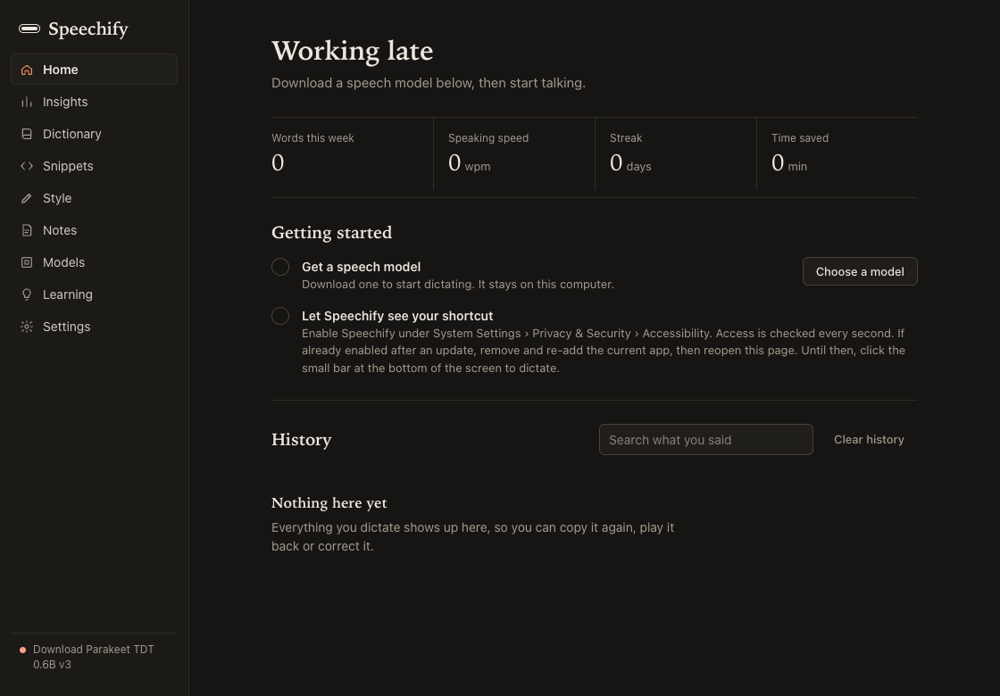
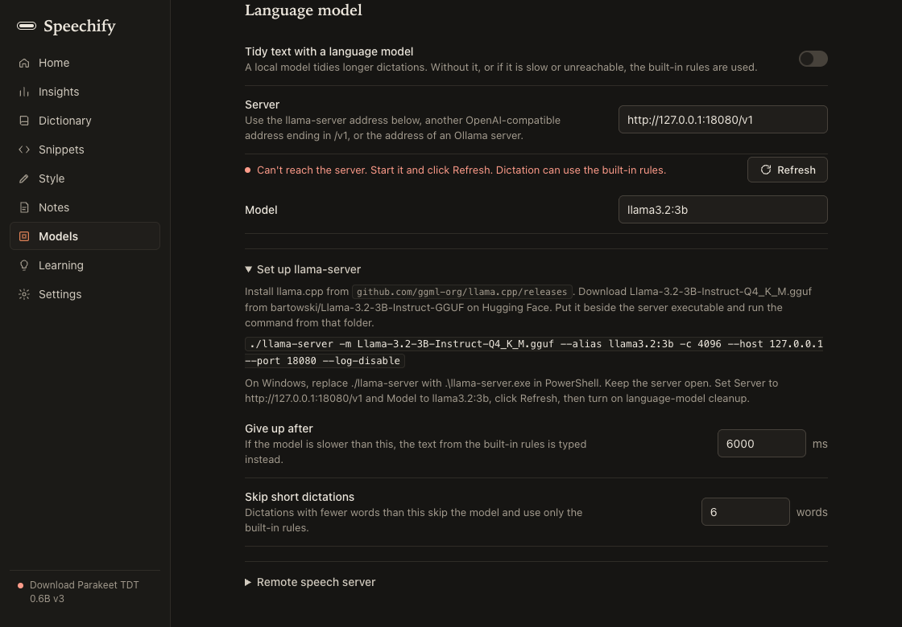
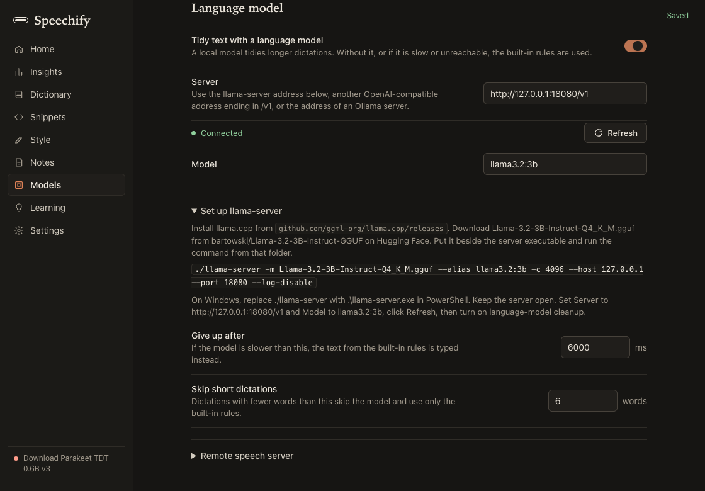

# llama-server setup and latency validation

## Mac trial

The Apple M3 replay used the installed Parakeet TDT v3 on Metal and the Speechify processing pipeline. The 11-second JFK fixture was replayed as supplied and doubled for a 22-second input. Each cell is the median of five warm runs. Pipeline totals include voice detection, recognition and cleanup, before paste. The separate cleanup fixture set has 38 existing formatting cases and nine synthetic notes and editing cases. The table reports the median of 47 model calls using the six-second timeout.

| Cleanup configuration | 47-case cleanup | 11 s pipeline | 22 s pipeline |
| --- | ---: | ---: | ---: |
| Ollama, Gemma 3 4B (previous default) | 1,548 ms | 2,310 ms | 2,602 ms |
| Ollama, Llama 3.2 3B | 365 ms | 1,005 ms | 1,336 ms |
| Standalone llama-server b12521, exact same Llama 3B GGUF as Ollama | 422 ms | 1,141 ms | 1,763 ms |
| Standalone llama-server b12521, GGUF from the new setup guide | 303 ms | 1,011 ms | 1,422 ms |

The guided setup cut replay time by 56% and 45% on these clips. The same-weights comparison shows that replacing Ollama alone did not improve the median. These are warm observations from one machine and one recording, without a microphone or clipboard round trip.

The guide's model exactly matched 26 of 47 expected cleanup texts, compared with Gemma's 20 of 47. Exact matches count punctuation and formatting differences. The guided model preserved the large rupee amount in this run, but returned “Send it today” after a correction to “tomorrow.” The Ollama Llama file missed both. This is why fresh installs start with built-in cleanup and ask users to opt in to the language model.

The [Windows CPU benchmark](https://github.com/Sumedhbhat/speechify/actions/runs/44370746866) used 47 cleanup inputs. Llama 3B took 914 ms in Ollama and 934 ms with the same weights through its direct runner. Gemma 4B timed out on every case. Windows and Mac ran on different hardware.

## Fresh setup

The [clean setup matrix](https://github.com/Sumedhbhat/speechify/actions/runs/44375398900) downloaded the official server archive and the guide's model into a new temporary directory, verified their hashes, started the server on loopback, found the model through `/v1/models`, and sent a cleanup request. It passed on Windows x64, macOS Apple Silicon and Intel, and Ubuntu x64 and ARM. This matrix exercises the companion server setup. The Speechify installer builds run in the PR's release workflow.

The screenshots below use the production frontend with controlled Tauri responses for the first-run, disconnected and connected states. The local macOS trial also used the actual app and server.

| Fresh profile | Server setup | Connected |
| --- | --- | --- |
|  |  |  |
