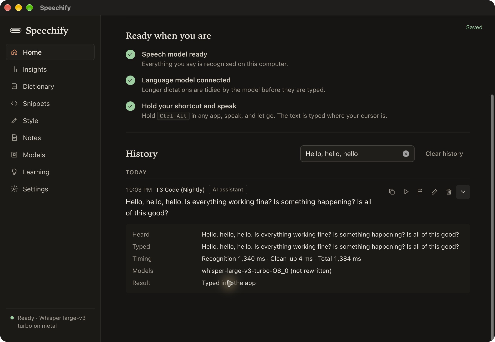
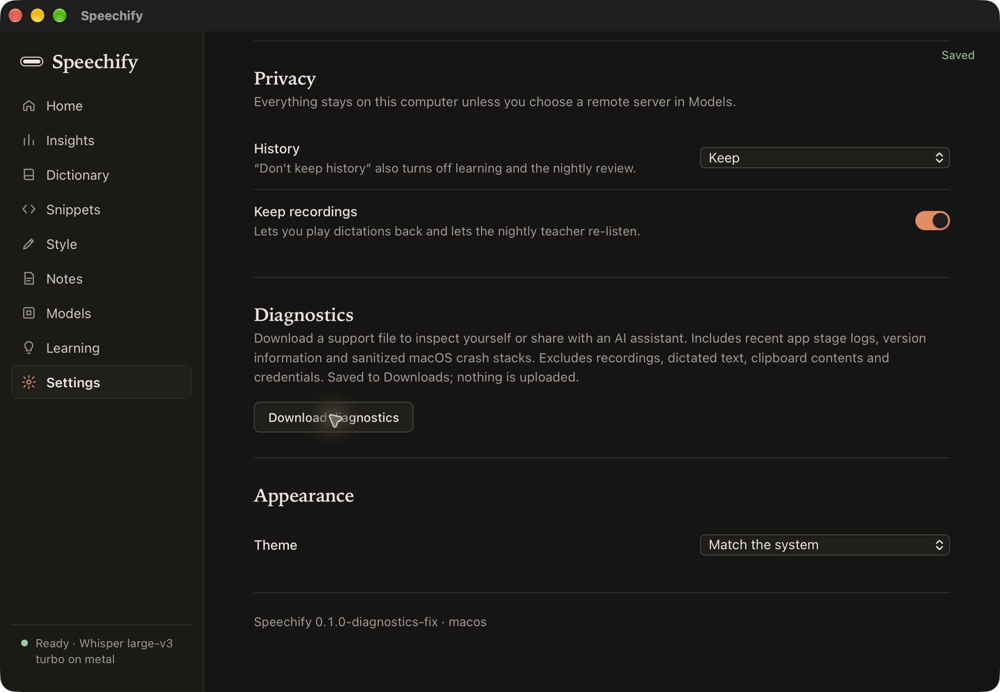

# macOS candidate validation

Tested the installed `0.1.0-diagnostics-fix` candidate on 17 November 2026.

- The user re-added the updated ad-hoc-signed app in Accessibility without restarting it. The existing keyboard worker detected `granted`.
- The user physically held Ctrl+Alt, dictated and released it, and confirmed that the text pasted successfully. The new logs show capture, detection, transcription, paste and completion.
- The actual app History shows the completed test dictation as “Typed into the app.” The screenshot filters out unrelated dictations.
- Settings → Diagnostics → Download diagnostics produced a readable local JSON file with both log statuses and three sanitized crash summaries. The older native SIGTRAP stack and the two baseline Cmd+Q SIGABRT stacks were present, without raw reports or private report fields.
- Cmd+Q on the candidate logged menu quit, worker shutdown completion and explicit exit. The process stopped and no new macOS crash report appeared. Reopening the candidate succeeded.
- The temporary change to “Mute other audio” was restored to its original enabled state.

The original input-source SIGTRAP did not reproduce on the newer diagnostic baseline or candidate. The patch removes the off-main native keyboard-layout call pattern identified in the historical crash stack; these trials do not establish that every possible quit has been eliminated. Cmd+Q's separate native teardown abort was reproduced on the baseline twice and did not recur in the candidate test.

## Selected real stage records

These are copied from the installed candidate's local log. They contain no dictated text.

```text
1794933082135 pid=7404 thread=ThreadId(1) stage=app.version 0.1.0-diagnostics-fix
1794933164432 pid=7404 thread=ThreadId(11) stage=keyboard.access granted
1794933173431 pid=7404 thread=ThreadId(12) stage=capture.start ok
1794933173451 pid=7404 thread=ThreadId(12) stage=capture.stop end elapsed_ms=16
1794933175960 pid=7404 thread=ThreadId(12) stage=capture.start ok
1794933181975 pid=7404 thread=ThreadId(12) stage=capture.stop end elapsed_ms=12
1794933182011 pid=7404 thread=ThreadId(12) stage=speech.detect ok
1794933183326 pid=7404 thread=ThreadId(12) stage=speech.transcribe ok
1794933183386 pid=7404 thread=ThreadId(12) stage=typing.paste begin
1794933183520 pid=7404 thread=ThreadId(12) stage=typing.paste ok
1794933183521 pid=7404 thread=ThreadId(12) stage=typing.paste end elapsed_ms=134
1794933183528 pid=7404 thread=ThreadId(12) stage=bar done
1794933195933 pid=7404 thread=ThreadId(1) stage=app.quit menu
1794933195934 pid=7404 thread=ThreadId(1) stage=app.quit worker_requested
1794933195936 pid=7404 thread=ThreadId(12) stage=worker shutdown_complete
1794933195936 pid=7404 thread=ThreadId(1) stage=app.exit_requested explicit
```

## Installed app screenshots




